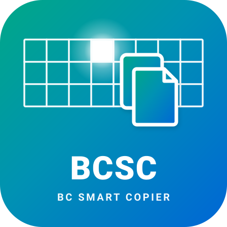
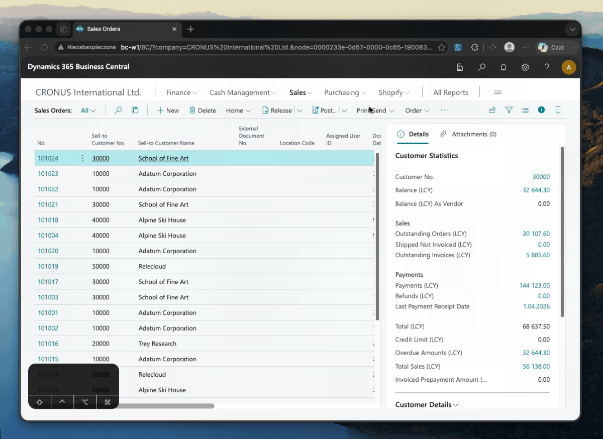

  

<h1 align="center">BC Smart Copier</h1>

  A lightweight browser extension for <b>Microsoft Dynamics 365 Business Central</b>.

---

## 🎬 Demo

  

---

## 🚀 Shortcuts & Actions

| Default shortcut | Action | Example output |
|---|---|---|
| `Shift` + **Click** | Copy cell value | `10000` or `[No.]` |
| `Alt` + `Shift` + **Click** | Copy action path | `open page [Sales Orders] and go to [Related] tab -> [Documents] and click {Prepayment Invoices}` |
| Hold `Alt` + **Click** a table | Copy whole table (TSV) | Rows and columns ready to paste into Excel |

| BC error → **Copy for AI agent** / **Copy for Jira** | Copy an error report | Environment, page, error, call stack and current record |

On Mac, `Alt` is the `⌥ Option` key and `Ctrl` also matches `⌘ Cmd`. The popup shows macOS key symbols (`⇧` `⌥` `⌘`).

### ⌨️ Custom shortcuts

All three shortcuts can be changed in the extension popup (**Keyboard shortcuts** section). Available options: `Shift`, `Alt`, `Ctrl / Cmd ⌘` and the combinations `Alt + Shift`, `Ctrl + Shift`, `Ctrl + Alt`. Each action must use a different shortcut.

> **Warning**: `Ctrl / Cmd ⌘ + Click` is used by Business Central to select multiple rows. While a shortcut using `Ctrl / Cmd ⌘` is active, that multi-row selection will not work.

---

## 💡 How it works

### Copy Cell Value — `Shift` + Left Click
1. Hold **SHIFT** (**⇧** on Mac).
2. Left-click any cell, field, or column header in Business Central.
3. The clean text value is automatically sanitized and copied to your clipboard (Boolean fields are copied as `Yes` / `No`).
4. The cell briefly highlights in green, and a Toast notification displays the copied value.

### Copy Action Path — `Alt` + `Shift` + Left Click
1. Hold **ALT + SHIFT** (or **⌥ OPTION + ⇧ SHIFT** on Mac).
2. Left-click any action button in the BC toolbar or action bar.
3. The extension extracts the **Page Name**, **Active Tab**, **Submenu hierarchy**, and **Action Button label** and copies a structured path to your clipboard.
4. Examples:
   - **Direct action**: `open page [Sales Order] and go to [Home] tab and click {Post}`
   - **Nested submenu**: `open page [Sales Orders] and go to [Related] tab -> [Documents] and click {Prepayment Invoices}`

### Copy Whole Table — hold `Alt` + Left Click
1. Hold **ALT** (or **⌥ OPTION** on Mac) and point at any table — it gets a green outline (a separate overlay; the table's own styles are not changed).
2. Click the outlined table.
3. All visible rows and cells (`th` / `td`) are copied as tab-separated text (TSV) — paste with `Ctrl + V` into Excel or Google Sheets to get the same rows and columns.
4. Releasing the key, moving off the table or switching windows removes the outline. Without the key held, the page works as usual.

### Error Reports — Copy for AI agent / Copy for Jira
1. When BC shows an error dialog or a field validation error (red field), two buttons appear in a panel at the bottom center of the page — for dialogs also under the message.
2. **Copy for AI agent** copies Markdown with the error and a short task for an agent that has your knowledge base (documentation, Jira issues, application code) — the task text is editable in the popup. **Copy for Jira** copies the same data as Jira markup / rich text, starting with `Summary:` and `Environment:` lines.
3. The report contains:
   - **Environment** from the page address — rules in the popup, one `fragment = name` per line, first match wins (default `STG = STG`, `QA = QA`, `client = PROD`);
   - company, page, record, field, time and URL;
   - the error message and BC's **technical details** (AL call stack) — the extension clicks BC's own *Copy error details* item and takes its text;
   - the **record**: all fields of the page and the focused row of each grid (e.g. document header + current line), with column names.
4. Optional **screenshot** (popup → *Error reports*): the first click also captures the visible tab, and the button changes to **Copy screenshot** — click it and a small extension tab copies the image and closes itself (needed because `http://` BC pages cannot put images into the clipboard).

> **Note**: All shortcuts block the whole click gesture (`preventDefault()` / `stopPropagation()`) to prevent unintended BC or browser actions — such as link navigation, entering edit mode, opening report request pages, or the browser's Shift + Click (new window) and Alt + Click (download) link behavior.

---

## ✨ Key Features

- **Smart Text Sanitization**: Automatically converts non-breaking spaces (`\u00A0`), normalizes line breaks, and trims excess whitespace.
- **Stacked Toast Feedback**: Green cell outline animation and stacked floating Toast notifications (anchored bottom-center, top-inserted, 4-second duration, capped at 5 visible toasts).
- **Toggle Control & Custom Shortcuts**: Enable or disable the extension and choose your own shortcuts via the toolbar popup.
- **Error Reports**: One click turns a BC error into a ready report for an AI agent or a Jira issue.
- **100% Private & Local**: Runs entirely inside your browser with zero external network tracking or data collection. Error reports only go to your clipboard.

---

## 🛠️ Installation Guide (Microsoft Edge / Google Chrome)

Load directly from source files (Developer Mode):

### For Microsoft Edge:
1. Open Microsoft Edge and go to: `edge://extensions`
2. Turn on the **Developer mode** toggle in the bottom left corner.
3. Click **Load unpacked**.
4. Select the project directory.
5. Done! The extension icon will appear in the toolbar.

### For Google Chrome:
1. Open Google Chrome and go to: `chrome://extensions`
2. Turn on the **Developer mode** toggle in the top right corner.
3. Click **Load unpacked**.
4. Select the project directory.
5. Done!

---

## 📂 Project Structure

- `manifest.json` – Extension configuration (Manifest V3).
- `content/content.js` – Two configurable shortcuts: copy cell value (default `Shift + Click`) and copy the full action path including submenus (default `Alt + Shift + Click`, Page › Tab › Submenu › Action), and Table Copier (default hold `Alt` + click a table).
  It also detects BC errors and adds the error report buttons.
- `content/page-hook.js` – Runs in the page context; while an error report is being built it takes the text BC's *Copy error details* writes to the clipboard.
- `background.js` – Service worker that takes the optional error screenshot.
- `screenshot/` – Short-lived page that copies the screenshot to the clipboard.
- `content/content.css` – Styles for cell highlight animation, Toast notifications, Table Copier overlay and error report buttons.
- `popup/` – Popup interface: enable/disable toggle, shortcut configuration and error report settings.
- `assets/icons/` – Extension icons set (SVG sources & PNG formats).
- `assets/docs/` – Documentation assets and demo recordings.

---

## 📜 Changelog

See [CHANGELOG.md](CHANGELOG.md) for full version history and release notes.